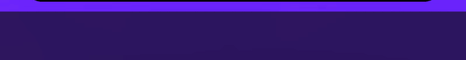
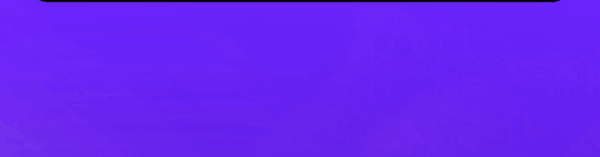
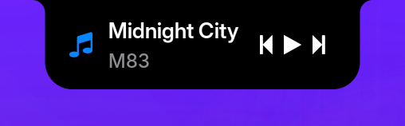

<h1 align="center">island</h1>

<p align="center">
  Un notch para bspwm, con la mecánica del Dynamic Island: se repliega
  cuando no hace falta y se despliega con lo que está pasando.
</p>

<p align="center">
  
  
  
  
</p>

<p align="center">
  
</p>

---

## Por qué

Una barra de estado en un gestor de mosaico ocupa una franja a todo lo ancho
de la pantalla para enseñarte, casi siempre, nada. La mía eran 898 píxeles de
los que solo el 10% tenía contenido; el resto era negro esperando a que
pasara algo.

El notch del MacBook resuelve eso de una forma que me parece honesta: el
hueco ya está perdido por el hardware, así que lo usan para lo que importa y
el resto del tiempo no está. El Dynamic Island da el paso siguiente — la
misma pieza cambia de tamaño según lo que tenga que decirte.

island es eso para bspwm. En reposo es una pastilla pequeña pegada al borde.
Cuando llega una notificación se abre en tarjeta; cuando tocas el volumen se
estira en una píldora con el deslizador; cuando levantas una VPN se queda con
la IP hasta que la bajas.

**Por qué no es una configuración de polybar.** Lo intenté primero. Polybar
dibuja texto y repinta la barra entera en cada actualización: se puede
falsear una animación imprimiendo fotogramas, pero son redibujados X11
completos, el ancho salta por anchos de carácter y a 20-30 fps ya se ve a
tirones. Además las esquinas redondas tienen que salir de glifos de una
fuente, y los de Nerd Fonts no son semicírculos de verdad — medidos, su
relación ancho/alto es 0.467 en vez de 0.5.

Aquí la ventana es un lienzo transparente y la forma se dibuja con cairo. Sale
gratis lo que allí costaba: geometría exacta, 60 fps reales y animaciones con
física.

## Qué hace

<p align="center">
  
</p>

**Se repliega.** `top_padding` a 0: las ventanas usan la pantalla entera y el
notch deja asomar 3 píxeles. Baja al acercar el ratón al borde superior, y
también solo cuando hay algo que enseñar — un cambio de escritorio, una
notificación, el cargador enchufado.

**Escritorios.** Una pista de segmentos con una píldora que se desliza al
cambiar. Clic izquierdo salta a ese escritorio; clic derecho abre los ajustes
del mosaico (monocle, equilibrar, rotar, separación, no molestar).

<p align="center">
  
</p>

**Notificaciones.** Entran por una regla de dunst, que deja de pintar su
propia burbuja y se las pasa al notch. El icono sale del tema de iconos o del
que mande la aplicación; el marcado HTML del cuerpo se limpia antes de
pintarlo.

Para las notificaciones web hay reglas en `apps.json`: Chrome manda todas las
suyas como «Google Chrome», así que se cruzan el nombre, el título, el cuerpo
y la URL de origen contra una lista de patrones. Si casa, se baja el favicon
**del propio sitio** — no de un servicio de terceros, que sabría qué páginas
te escriben.

<table>
  <tr>
    <td></td>
    <td></td>
  </tr>
  <tr>
    <td></td>
    <td></td>
  </tr>
</table>

**Paneles.** Cada icono de estado abre el suyo: volumen con deslizador real,
perfiles de energía, redes wifi —con entrada de contraseña dentro del propio
notch— y un calendario. El reloj abre el calendario; el botón de encendido, el
menú de sesión.

<p align="center">
  
</p>

**Lanzador.** Aplicaciones, ventanas abiertas, una calculadora y ejecución de
comandos, en una sola lista ordenada por relevancia y por uso. Las ventanas
van primero a propósito: en un gestor de mosaico lo que sueles querer es
saltar a algo que ya tienes abierto, no abrir otra instancia.

La calculadora no usa `eval()`: recorre el árbol de sintaxis y rechaza
cualquier nodo que no sea aritmética. Un lanzador evaluando lo que tecleas
sería ejecutar código arbitrario.

**Reproducción.** Lo que suene por MPRIS aparece con carátula y controles.

<p align="center">
  
</p>

## Cómo funciona

Una ventana `DOCK` transparente a todo el ancho, pegada arriba. No se
redimensiona nunca: lo que cambia es el dibujo. Redimensionar una ventana X11
no lo anima el compositor y se vería a saltos.

**Animación con muelles, no con curvas.** Un muelle amortiguado por cada
propiedad animada (ancho, alto, posición vertical, fundido, realce del ratón,
píldora de escritorios). La razón es que el destino puede cambiar a mitad de
animación — llega una notificación mientras se repliega otra — y un muelle
arrastra la velocidad que llevaba. Una curva de Bézier habría que reiniciarla,
y se ve el salto.

**Forma.** Canto recto arriba contra el borde de la pantalla, esquinas
redondeadas abajo, y los enlaces cóncavos donde el notch encuentra el borde.
Esos filetes son la diferencia entre parecer tallado en el panel y parecer una
pieza pegada encima.

**Eventos.** Un FIFO en `$XDG_RUNTIME_DIR`, una línea JSON por evento, y un
cliente (`island-send`) para escribir en él. Todo lo que no sea estado del
sistema entra por ahí: la regla de dunst, los scripts de volumen y brillo, y
cualquier cosa que quieras añadir tú.

```sh
island-send notify --app "CI" --body "build #284 · 2 min 14 s"
island-send panel --target launcher
island-send music --title "Midnight City" --artist "M83"
```

**Coste en reposo.** El contenido se reconstruye 12 veces por minuto, no 72:
el reloj muestra `HH:MM`, así que 59 de cada 60 refrescos no cambiaban un
píxel. El bucle de animación se detiene del todo cuando los muelles se
asientan, los layouts de Pango se cachean, y la IP se lee por `ioctl` en vez
de lanzar `ip` como subproceso.

## Instalación

Hacen falta Python 3.9+, GTK 3 y PyGObject, que en Debian y derivadas son:

```sh
sudo apt install python3-gi python3-gi-cairo gir1.2-gtk-3.0 gir1.2-rsvg-2.0
```

Opcionales, según lo que quieras que funcione: `playerctl` (reproducción),
`nmcli` (wifi), `wpctl` de PipeWire (volumen), `dunst` (notificaciones),
`xclip` (copiar desde la calculadora).

```sh
git clone https://github.com/bolado-dev/island ~/.config/island
```

En tu `bspwmrc`:

```sh
~/.config/island/launch.sh &
```

Y para que las notificaciones lleguen, al final de tu `dunstrc`:

```ini
[isla]
    appname = "*"
    script = ~/.config/island/hooks/dunst-notify.sh
    skip_display = true
```

La regla va **la última**: en dunst gana la última que casa.

## Configuración

`config.py` tiene lo que cambia de una máquina a otra — comando de bloqueo,
terminal, mezclador, nombres de las interfaces de red. `theme.py` tiene el
aspecto: colores, tamaños, tipografías y las constantes del auto-ocultado.

Los perfiles de energía esperan un script que fije el EPP de `intel_pstate` y
una regla en `/etc/sudoers.d` que lo permita sin contraseña. Si no existe, el
panel enseña solo el estado de la batería en vez de botones que no harían
nada.

El juego de iconos se cambia con `USAR_SOLAR` en `theme.py`. Por defecto usa
glifos de Nerd Fonts; a `True` usa SVG de [Solar](https://www.figma.com/community/file/1166831539721848736),
que se bajan con `./fetch-icons.sh`.

## Limitaciones

- **Un solo monitor.** Se dibuja en el primero que devuelve GTK. No he
  probado nada con varios.
- **X11 y bspwm.** El indicador de escritorios habla `bspc`; el auto-ocultado
  usa `top_padding`. Portarlo a otro gestor es cambiar `sources.Bspwm`, pero
  no está hecho.
- **Las notificaciones de Chrome desde una pestaña normal no se pueden
  identificar.** Chrome no publica el origen: llegan con nombre «Google
  Chrome» y sin icono. Instalar el sitio como aplicación de Chrome sí hace que
  mande el nombre y el favicon correctos.
- **La interfaz está en español.** Las cadenas están sueltas en el código, sin
  gettext.

## Licencia

MIT.
