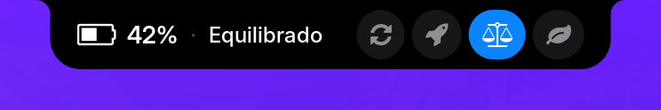
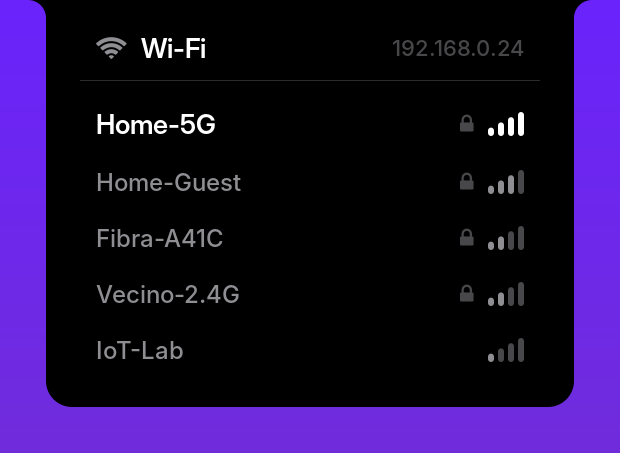
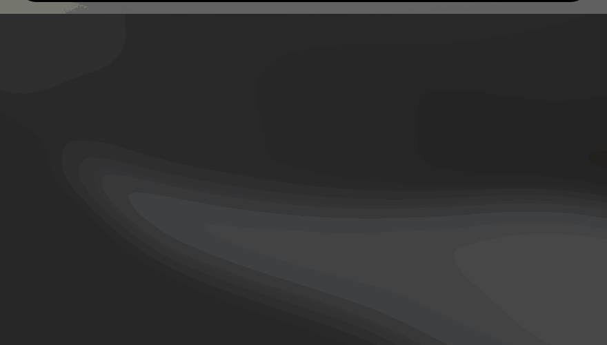
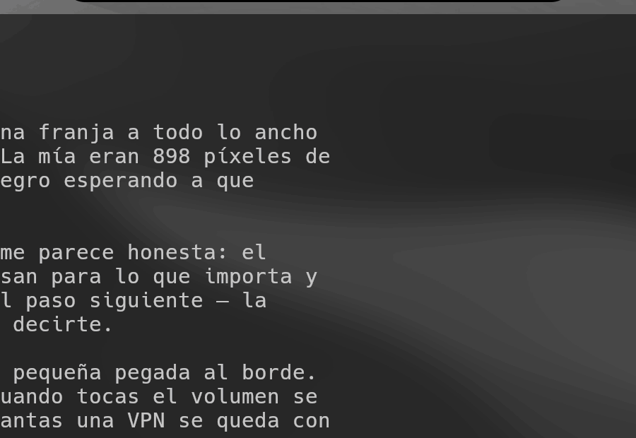

<p align="center">
  
</p>

<h1 align="center">island</h1>

<p align="center">
  Un notch para bspwm, con la mecánica del Dynamic Island: se repliega
  cuando no hace falta y se despliega con lo que está pasando.
</p>

<p align="center">
  
  
  
  
</p>

<p align="center">
  
</p>

---

## Por qué

Una barra de estado en un gestor de mosaico ocupa una franja a todo lo ancho
de la pantalla para enseñarte, casi siempre, nada. La mía eran 898 píxeles de
los que solo el 10% tenía contenido; el resto era negro esperando a que
pasara algo.

El notch del MacBook resuelve eso de una forma que me parece honesta: el
hueco ya está perdido por el hardware, así que lo usan para lo que importa y
el resto del tiempo no está. El Dynamic Island da el paso siguiente — la
misma pieza cambia de tamaño según lo que tenga que decirte.

island es eso para bspwm. En reposo es una pastilla pequeña pegada al borde.
Cuando llega una notificación se abre en tarjeta; cuando tocas el volumen se
estira en una píldora con el deslizador; cuando levantas una VPN se queda con
la IP hasta que la bajas.

**Por qué no es una configuración de polybar.** Lo intenté primero. Polybar
dibuja texto y repinta la barra entera en cada actualización: se puede
falsear una animación imprimiendo fotogramas, pero son redibujados X11
completos, el ancho salta por anchos de carácter y a 20-30 fps ya se ve a
tirones. Además las esquinas redondas tienen que salir de glifos de una
fuente, y los de Nerd Fonts no son semicírculos de verdad — medidos, su
relación ancho/alto es 0.467 en vez de 0.5.

Aquí la ventana es un lienzo transparente y la forma se dibuja con cairo. Sale
gratis lo que allí costaba: geometría exacta, 60 fps reales y animaciones con
física.

## Qué hace

<p align="center">
  
</p>

**Se repliega.** `top_padding` a 0: las ventanas usan la pantalla entera y el
notch deja asomar 3 píxeles. Baja al acercar el ratón al borde superior, y
también solo cuando hay algo que enseñar — un cambio de escritorio, una
notificación, el cargador enchufado.

**Escritorios.** Una pista de segmentos con la píldora del activo. La píldora
no viaja entre huecos: nace como un punto en el escritorio nuevo y se estira
hasta su tamaño mientras el anterior hace el gesto al revés, encogiendo y
apagándose. Verla cruzar por encima de los escritorios de en medio arrastraba
la mirada por un camino que no importa, y el cambio lo acabas de pulsar tú.

Un solo muelle gobierna la entrada y la salida, así que no pueden
desacompasarse. Se ajusta con `WS_POP` y `SP_POP_*` en `theme.py`, y
`WS_ANIM` devuelve el deslizamiento si lo prefieres.

Clic izquierdo salta a ese escritorio; clic derecho abre los ajustes del
mosaico (monocle, equilibrar, rotar, separación, no molestar).

<p align="center">
  
</p>

**Notificaciones.** Entran por una regla de dunst, que deja de pintar su
propia burbuja y se las pasa al notch. El icono sale del tema de iconos o del
que mande la aplicación; el marcado HTML del cuerpo se limpia antes de
pintarlo.

Para las notificaciones web hay reglas en `apps.json`: Chrome manda todas las
suyas como «Google Chrome», así que se cruzan el nombre, el título, el cuerpo
y la URL de origen contra una lista de patrones. Si casa, se baja el favicon
**del propio sitio** — no de un servicio de terceros, que sabría qué páginas
te escriben.

<table>
  <tr>
    <td></td>
    <td></td>
  </tr>
  <tr>
    <td></td>
    <td></td>
  </tr>
</table>

**Paneles.** Cada icono de estado abre el suyo: volumen con deslizador real,
perfiles de energía, redes wifi —con entrada de contraseña dentro del propio
notch— y un calendario. El reloj abre el calendario; el botón de encendido, el
menú de sesión.

<p align="center">
  
</p>

**Lanzador.** Aplicaciones, ventanas abiertas, una calculadora, ejecución de
comandos y lo último que has copiado, en una sola lista ordenada por
relevancia y por uso. Las ventanas
van primero a propósito: en un gestor de mosaico lo que sueles querer es
saltar a algo que ya tienes abierto, no abrir otra instancia.

La calculadora no usa `eval()`: recorre el árbol de sintaxis y rechaza
cualquier nodo que no sea aritmética. Un lanzador evaluando lo que tecleas
sería ejecutar código arbitrario.

El historial del portapapeles solo aparece **cuando escribes algo**: sin
búsqueda, lo que quieres es saltar a una ventana o abrir un programa, que es a
lo que se abre el lanzador el 95% de las veces. Y no toca el disco a
propósito: por el portapapeles pasan contraseñas, y lo que no se guarda no se
filtra.

**Y tiene panel propio en `super + v`**, como el de Windows: la lista de lo
último copiado, numerada, con las flechas para moverte y `⏎` para pegarlo **en
la ventana que tenías delante** --no en el portapapeles para que lo pegues tú-.
Escribir filtra. Es el mismo historial que ve el lanzador, así que no hay dos
listas que puedan discrepar.

Lo que no sale ahí son las imágenes: el historial es de texto. Después de una
captura, el portapapeles tiene un PNG y `xclip -o` devuelve bytes que no son
UTF-8; el sondeo se come esa excepción y sigue, así que la imagen se ignora sin
ensuciar la lista. Es además la única pieza de la isla que sondea, porque X no avisa de
un cambio de selección a quien no se registra con XFixes y eso significaba
meter un segundo bucle de eventos de X dentro de una aplicación GTK. Medido,
la alternativa tonta sale a 0,1% de un núcleo: un `xclip -o` son 3 ms, uno
cada tres segundos.

<p align="center">
  
</p>

**Selector de emoji**, en `super + .` como el de Windows. Escribes, eliges y el
emoji aparece **en la ventana que tenías delante**, no en el portapapeles para
que lo pegues tú. Las flechas mueven, el tabulador salta de grupo y los que
más usas salen los primeros.

**Busca en castellano**, que es lo que uno escribe: «fuego» encuentra 🔥 y
«cohete» 🚀. Los nombres salen de [CLDR](https://github.com/unicode-org/cldr)
y los baja `fetch-icons.sh`; hacen falta sus dos ficheros, porque
`annotations` solo trae los emoji de un carácter y sin `annotationsDerived`
—la familia de cuatro, las banderas, los oficios— se queda en el 83%. También
busca por el nombre en inglés, porque media jerga de emoji se dice así. Sin
el fichero no se rompe nada: se busca solo en inglés, que es lo que trae el
sistema.

**La lista es la del sistema, no una copia.** `emoji-test.txt` (paquete
`unicode-data`) es la lista oficial del consorcio, con el orden y los grupos
ya decididos por ellos y pensados justo para una paleta de teclado. De los
3947 que trae se enseñan 1914: se quitan las variantes de tono de piel, que
multiplican por seis cada emoji de persona y dejarían la rejilla llena de la
misma mano repetida.

**La rejilla puede ser uniforme porque se midió.** A 30 píxeles, los 1914
emoji miden 37 × 36 **exactos** con Noto Color Emoji —banderas, teclas y
familias de cuatro incluidas—, así que la celda es fija y las columnas salen
rectas sin medir una por una.

**Y se filtra lo que la fuente no sepa dibujar**, porque los datos de Unicode
van por delante de las fuentes y un emoji sin glifo sale como un cuadro vacío.
No vale preguntar por los glifos desconocidos, que es lo que uno haría:
fontconfig tapa el hueco con otra fuente y Pango informa de cero. Lo que sí se
ve es el **ancho**: un emoji dibujado de verdad ocupa una casilla y una
secuencia que la fuente no conoce se descompone en sus piezas y ocupa el
doble exacto. Son 150 ms una vez, en un hilo mientras arranca el escritorio,
para que abrir el selector no espere nunca.

Un detalle que obligó a que los emoji no sean texto normal: **una fuente de
color ignora el color de origen de cairo, y con él el alfa**. Pidiendo
`rgba(1,1,1,0)` el emoji sale igual de opaco, así que con un `Text` corriente
se habría colado entero en mitad de los fundidos de la isla. Dibujarlo en un
grupo y volcarlo con `paint_with_alpha` sí funde.

El pegado es el mismo código que el del dictado (`sources.pegar`): las dos
cosas hacen exactamente lo mismo, dejar algo en la ventana que tenías
delante, y dos copias se habrían separado en cuanto una aprendiese algo.

<p align="center">
  
</p>

**Capturas de pantalla.** `Print` selecciona una región, `ctrl + Print` coge la
pantalla entera y `alt + Print` la ventana enfocada. Baja el notch con **la
miniatura de verdad** de lo que acabas de capturar, el tamaño, y tres botones:
abrirla, abrir la carpeta o borrarla. Queda en `~/ScreenShots` y copiada al
portapapeles, porque una captura casi siempre es para pegarla en otro sitio.

Borrar ahí mismo es la razón de ser de la tarjeta: la mitad de las capturas se
hacen para mirarlas diez segundos, y si no tienes dónde tirarlas se quedan en
la carpeta para siempre.

**El notch se aparta antes de disparar.** Encadenar dos capturas es lo normal,
y la tarjeta de la primera sigue a la vista cuando disparas la segunda: saldría
en la foto. Se le pide que se repliegue y se espera a que lo haga. Eso obligó a
arreglar algo que venía de antes: **el repliegue solo se programaba al salir el
ratón o al cambiar de escritorio**, nunca al caducar lo que se estaba
enseñando, así que el notch se quedaba abajo hasta que lo rozabas.

**La miniatura la hace el ayudante, no la isla.** Medido aquí: sacarla del PNG
completo son 34 ms y sacarla de la miniatura ya hecha, 1. Lo que importa no es
el factor treinta, es que esos 34 ms caerían en el hilo de GTK --dos fotogramas
perdidos- justo en la animación de entrada de la tarjeta.

Y la miniatura no es un `Image` con otra foto dentro: ese es cuadrado, porque un
icono de aplicación y una carátula lo son. Una captura no, y meterla en un
cuadrado la deformaría o recortaría justo lo que te hizo capturarla. Manda el
alto, el ancho sale de la proporción y hay un tope por si capturas algo muy
alargado.

**El subtítulo tiene ancho fijo**, el del texto más largo que puede salir ahí.
Al señalar un botón, donde ponía el tamaño pone lo que hace ese botón --así la
etiqueta vive en un sitio y no en tres chips que ensancharían la tarjeta-, y sin
reservar el hueco la tarjeta se encogía al señalar: lo que se movía era justo el
botón que estabas a punto de pulsar.

<p align="center">
  
</p>

**La selección es propia**, no la de otro programa. El escritorio se congela, se
atenúa, y lo que eliges se queda a brillo pleno: escuadras azules en las
esquinas, el tamaño en una pastilla negra con la misma tipografía del notch, y
una cruz tenue por el cursor antes de empezar. Arrastras y sueltas; `esc`, el
botón derecho o un clic sin arrastrar cancelan.

**Congela sin congelar X.** Lo primero que probé fue `scrot --select`, que no
pinta **nada** encima --solo cambia el cursor y traza una línea fina al
arrastrar-, así que al pulsar el atajo parecía que no había pasado nada. Y su
`--freeze` lo hace con `XGrabServer`: mientras eliges, ningún otro cliente de X
puede dibujar, y si el que captura se colgase, el escritorio entero se quedaría
tieso detrás.

Aquí es al revés: se saca una foto del escritorio --19 ms, y coincide con lo que
da scrot al 0,00%- y se enseña a pantalla completa. Lo que ves está quieto
porque es una foto, no porque el servidor esté bloqueado. De propina, la región
se recorta de **esa misma foto**, así que ni el velo ni el marco ni la etiqueta
pueden acabar dentro de la captura por mucho que se dibujen encima.

Es una ventana `POPUP` a propósito: una normal la gestionaría bspwm, la
colocaría en el mosaico y se vería el tirón. Y la captura de teclado se
**reintenta** 24 veces cada 25 ms, porque con `super + shift + s` --que dispara
al pulsar- sxhkd todavía tiene el teclado agarrado cuando esto arranca; al
primer intento el servidor contesta `ALREADY_GRABBED` y sin reintentar el
selector se cerraría solo sin decir nada. Mismo caso que el lanzador con
`super + d`.

La pantalla entera y la ventana siguen siendo `scrot`, que para eso no hace
falta interfaz ninguna. `CAPTURA_SELECTOR` en `config.py` devuelve la selección
a scrot si algún día hace falta.

`super + shift + s` hace lo mismo que `Print` a secas. Es un atajo de más a
propósito: es el que está en los dedos de tanto usarlo, y una tecla que ya sabes
pulsar vale más que una coherencia bonita.

**Reproducción.** Lo que suene por MPRIS aparece con carátula y controles.

<p align="center">
  
</p>

**Avisa cuando la IA termina.** Te vas a otra ventana mientras Claude trabaja
y el notch baja a decirte que ha acabado, con su logo y lo que tardó. La señal
es el girador que las CLI de IA ponen delante del título del terminal: cuando
desaparece, han terminado. Vale para cualquiera que haga eso, sin
configurarla.

Avisa de **todos**, dure lo que dure. La duración solo se enseña si se vio
empezar: a una ventana que ya estaba trabajando cuando arrancó la isla no se le
inventa un tiempo, porque un número se lee como un dato. Lo único que lo calla es tener esa
ventana delante, porque entonces lo estás viendo. Hubo un mínimo de diez
segundos y se quitó: como el foco ya filtra lo que estás mirando, el reloj
solo servía para tragarse los avisos de lo que acaba rápido mientras estás en
otra cosa, que es justo cuando hacen falta. Si alguna CLI resulta apagar el
girador a mitad de trabajo, `TRABAJO_MINIMO` en `config.py` lo devuelve.

Lo que cuesta: un `ps` cada cinco segundos. La lista de ventanas, sus procesos
y sus títulos salen del servidor X por `ctypes`, sin lanzar `xprop` ni `xdotool`
para nada.

**Avisa de que hay un micrófono abierto.** Cualquier programa que capture
audio, no solo el dictado: el notch baja un momento con quién es y deja un
punto rojo mientras dure. Ahora que la isla sabe escuchar, lo honesto es que
sea también la que dice cuándo alguien escucha. Por eventos de PipeWire
(`pw-mon`), sin sondear, y el dictado se identifica con nombre propio para no
avisarse a sí mismo.

<p align="center">
  
</p>

**Dictado por voz.** Mantén `super + espacio`, habla y suéltalo: la isla se
despliega con la onda del micrófono, transcribe en local y escribe el texto
donde estabas. `super + shift + espacio` es el mismo dictado como interruptor, para
hablar largo sin tener la mano en la tecla.

Tres cosas que no son obvias:

**La onda es la señal real**, no una animación. Con una decorativa, un micro
silenciado se ve exactamente igual que una grabación buena, y te enteras
treinta segundos después al leer la transcripción vacía. Lo que sí es
animación es cómo llega: los niveles entran doce veces por segundo y la
pantalla va a sesenta, así que lo dibujado persigue a lo medido en vez de
copiarlo. Sin eso la onda avanza a saltos de cinco fotogramas, que es el tirón
que delata a una barra de sonido mal hecha.

**Sube rápido y baja despacio.** Grabando, la onda tiene que seguir a la voz
sin retraso o deja de ser la señal. Al soltar la tecla pasa lo contrario: lo
que quieres es *ver* cómo se cierra el micrófono, y a la velocidad de subida
eso dura 200 ms, o sea nada. Cayendo tarda 400, y se ve caer dentro de la
tarjeta que se está desvaneciendo, porque el fundido cruzado sigue dibujando
el contenido anterior mientras entra el nuevo.

Transcribiendo no hay micrófono ni onda: el micro está cerrado y ahí ya no hay
señal que enseñar. Lo único que pasa es una espera de la que nadie sabe cuánto
va a durar, y para eso basta el latido de tres puntos. Una barra de progreso
mentiría, porque whisper no informa de su avance.

**Parar no se lo puede pedir a sxhkd.** El atajo de soltado (`@super + space`)
solo casa si sueltas la `v` **antes** que super, y al levantar la mano del
teclado lo normal es lo contrario: entonces el soltado no lo ve nadie y el
dictado se queda grabando hasta el tope de dos minutos. Atar también el
soltado de super no vale, y no es teoría: `@super_l` rompe la propia
combinación, y con ella puesta dejaba de funcionar hasta el caso que antes iba
bien.

Así que mientras graba se le pregunta al servidor X si la tecla sigue pulsada,
por `ctypes` contra libX11 (`XQueryKeymap`), sin python-xlib y sin lanzar
`xinput` doce veces por segundo. Es la misma idea que leer la IP por `ioctl`
en vez de llamar a `ip`. Y como solo se vigila si la tecla estaba pulsada al
empezar, el interruptor de `super + shift + espacio` sigue funcionando: ahí está
suelta, y vigilarla pararía la grabación en el primer parpadeo.

**La ventana de destino se mira al empezar, no al terminar.** Mientras hablas
el foco puede cambiar solo —una notificación, un gesto del ratón— y el texto
acabaría escrito en cualquier parte. Al soltar, el texto va a la ventana que
tenías delante cuando empezaste.

**El notch avisa de que el dictado está disponible.** Cuando el foco entra en
una ventana de una IA aparece en reposo **su logo en blanco** junto a la
palabra «Dictado», y se va cuando el foco sale. Mismo criterio que el «no
molestar»:
aparece solo cuando significa algo, porque un icono permanente para un estado
que casi siempre está apagado es ruido fijo. El foco se consulta cuando
cambia (`bspc subscribe node_focus`), no en bucle: recorrer el árbol de
procesos cada pocos segundos para un indicador que casi nunca cambia sería
gastar batería en nada.

**Reconoce qué IA tienes delante y enseña su logo**, no su nombre: un logo se
reconoce de un vistazo y no hay que leerlo, que es lo que se necesita de algo
que está en pantalla dos segundos. Y no lo deduce del título: una terminal con
Claude Code dentro se titula con lo que esté haciendo la conversación, así que
el título dice de qué va la ventana pero no de qué programa es. Lo que sí lo
dice es el árbol de procesos.

Reconoce `claude`, `codex` y `gemini` (`sources.IAS`). Añadir otra es una
línea ahí y un SVG en `icons/`; si falta el SVG se enseña el nombre y ya. Los
logos salen de [simple-icons](https://simpleicons.org) y se pintan como
máscara, así que el fichero no guarda el color: el blanco lo pone el tema. El
texto se escribe igual en cualquier ventana, con IA o sin ella.

**El resultado se enseña hasta en tres líneas.** Tres es el tope por una
razón de forma: a partir de ahí la tarjeta deja de ser un aviso y se convierte
en un documento, y además el texto ya está pegado donde lo vas a leer de
verdad. Lo que sobra se corta con puntos suspensivos. Es el único estado que
cambia de alto según el contenido.

**El texto se pega, no se teclea.** Medido aquí: `xdotool type` se come las
vocales acentuadas ("grabe video" por "grabé vídeo"), porque remapea un código
de tecla por cada carácter que el teclado no tiene y con el retardo por
defecto el servidor X todavía no ha procesado el mapa nuevo cuando llega la
pulsación. Con `--delay 12` sale bien, pero una frase de 300 caracteres tarda
casi cuatro segundos en aparecer. Pegar no tiene ninguno de los dos problemas:
0,1 s y el portapapeles no pasa por el mapa de teclado. El atajo depende de
dónde se pega, y esa es toda la lista que hay que mantener: Ctrl+Shift+V en
las terminales, Ctrl+V en lo demás.

A whisper se le pasa además una **pista de estilo** (`DICT_PROMPT`), que el
modelo toma como «lo que se venía diciendo» y le hace puntuar y usar
mayúsculas, que en dictado corto es donde más falla. Es deliberadamente
genérica: meter ahí jerga propia mejora esas palabras y empeora el resto,
porque el modelo intenta encajarlas donde no tocan.

Transcribe [whisper.cpp](https://github.com/ggml-org/whisper.cpp) en la
máquina, sin red. El modelo se elige midiendo, no por fama: en un portátil sin
GPU, `small-q5_1` transcribe 11 segundos de audio en 2,9 y `large-v3-turbo`
tarda 18,7, o sea más que la propia frase. Está en `config.py`.

**La ventana del codificador se ajusta a lo que has hablado**, y es la
optimización más grande que admite esto. Whisper codifica siempre 30 segundos:
hables dos o veinte, esa parte cuesta lo mismo. Recortándola (`-ac`) a los
segundos que de verdad hay, medido aquí con `small`:

| | Ventana entera | Ajustada |
|---|---|---|
| 2,5 s de audio | 2488 ms | **918 ms** |
| 11 s de audio | 4934 ms | **3075 ms** |

Con el mismo texto, coma a coma. El margen del 35% tampoco es por gusto:
quedarse corto recorta el audio y se pierden las últimas palabras, que es un
fallo mucho peor que tardar un poco más.

De punta a punta, desde que sueltas la tecla: 4 ms en cerrar el micrófono,
716 en transcribir y 133 en pegar. Con `ISLAND_DEBUG=1` esos tres números se
escriben en `$XDG_RUNTIME_DIR/island-dictado/traza.log`, que es la única forma
de saber dónde se va el tiempo: el que graba es un proceso suelto sin terminal
a la que quejarse.

Y mientras grabas, un nivel nuevo **no reconstruye el contenido del notch**:
la onda lee la lista en vivo al dibujar, así que doce veces por segundo solo
se repinta, no se vuelve a medir con Pango un texto que no ha cambiado.

**Hay un modo demo**, `dictado.py demo ["frase"]`, que recorre la tarjeta entera
sin abrir el micrófono: con él está grabado el GIF de arriba. No dibuja una onda
de adorno —eso sería enseñar algo que el programa no hace—: sintetiza audio con
la envolvente de alguien diciendo esa frase, una ráfaga por sílaba y pausas
entre palabras, y lo pasa por el **mismo `nivel()`** que procesa el micrófono. La
ventana de destino sí es la de verdad, así que lanzado desde una terminal con una
IA dentro sale su logo. El ruido lleva semilla fija: un demo que sale distinto
cada vez no sirve ni para comparar dos versiones ni para volver a grabar el
mismo GIF.

Lo que no hace, a propósito: **el micrófono no se abre solo nunca**. Se abre
cuando pulsas la tecla y se cierra cuando la sueltas. Un dictado que escucha
"por si acaso" es un micro abierto en tu escritorio todo el día.

## Cómo funciona

Una ventana `DOCK` transparente a todo el ancho, pegada arriba. No se
redimensiona nunca: lo que cambia es el dibujo. Redimensionar una ventana X11
no lo anima el compositor y se vería a saltos.

**Animación con muelles, no con curvas.** Un muelle amortiguado por cada
propiedad animada (ancho, alto, posición vertical, fundido, realce del ratón,
píldora de escritorios). La razón es que el destino puede cambiar a mitad de
animación — llega una notificación mientras se repliega otra — y un muelle
arrastra la velocidad que llevaba. Una curva de Bézier habría que reiniciarla,
y se ve el salto.

**Forma.** Canto recto arriba contra el borde de la pantalla, esquinas
redondeadas abajo, y los enlaces cóncavos donde el notch encuentra el borde.
Esos filetes son la diferencia entre parecer tallado en el panel y parecer una
pieza pegada encima.

**Eventos.** Un FIFO en `$XDG_RUNTIME_DIR`, una línea JSON por evento, y un
cliente (`island-send`) para escribir en él. Todo lo que no sea estado del
sistema entra por ahí: la regla de dunst, los scripts de volumen y brillo, y
cualquier cosa que quieras añadir tú.

```sh
island-send notify --app "CI" --body "build #284 · 2 min 14 s"
island-send panel --target launcher
island-send music --title "Midnight City" --artist "M83"
```

**Coste en reposo.** El contenido se reconstruye 12 veces por minuto, no 72:
el reloj muestra `HH:MM`, así que 59 de cada 60 refrescos no cambiaban un
píxel. El bucle de animación se detiene del todo cuando los muelles se
asientan, los layouts de Pango se cachean, y la IP se lee por `ioctl` en vez
de lanzar `ip` como subproceso.

## Instalación

Hacen falta Python 3.9+, GTK 3 y PyGObject, que en Debian y derivadas son:

```sh
sudo apt install python3-gi python3-gi-cairo gir1.2-gtk-3.0 gir1.2-rsvg-2.0
```

Opcionales, según lo que quieras que funcione: `playerctl` (reproducción),
`nmcli` (wifi), `wpctl` de PipeWire (volumen), `dunst` (notificaciones),
`xclip` (copiar desde la calculadora), `unicode-data` más
`fonts-noto-color-emoji` para el selector de emoji, que sin la lista del
sistema te dice que falta en vez de abrirse vacío, y `scrot` para las capturas
de pantalla y de ventana. La selección de región no necesita nada: la dibuja la
propia isla.

Para el dictado hacen falta además `pw-record` (PipeWire), `xclip`, `xdotool`
(sin él el texto se queda en el portapapeles en vez de escribirse solo) y
whisper.cpp compilado:

```sh
git clone https://github.com/ggml-org/whisper.cpp ~/.local/share/whisper.cpp
cd ~/.local/share/whisper.cpp
cmake -B build -DCMAKE_BUILD_TYPE=Release && cmake --build build -j
./models/download-ggml-model.sh small-q5_1
```

Y `./fetch-icons.sh`, que además de los iconos de Solar baja los logos de las
IA a `icons/`. No se versionan, como el resto del arte ajeno, y aquí pesa más
el motivo: son marcas registradas. Sin ellos no se rompe nada, el notch enseña
el nombre en texto. Baja también los nombres de emoji en castellano a
`emoji-es.json`, que tampoco se versiona: es un dato derivado de algo que se
actualiza solo, y tenerlo dentro del repo significa tenerlo desactualizado.

Y el atajo, en tu `sxhkdrc`. El soltado es un atajo distinto (`@`), que es lo
que lo convierte en push-to-talk de verdad:

```
super + space
	~/.config/island/dictado.py start

@super + space
	~/.config/island/dictado.py stop
```

Si cambias de tecla, cámbiala también en `DICT_TECLA` (`config.py`): es la que
el ayudante le pregunta a X para parar al soltarla. Va con el nombre que le da
X y en minúsculas --`space`, no `Space`-, porque con la mayúscula
`XStringToKeysym` devuelve 0, no se vigila nada y la grabación se queda hasta
el tope.

Y los que van a un panel de la isla, que no necesitan nada más:

```
super + period
	~/.config/island/island-send panel --target emoji

super + v
	~/.config/island/island-send panel --target portapapeles
```

Y los de las capturas. El modificador va **delante**: escrito al revés
(`@Print + ctrl`) sxhkd no casa el acorde, se queda con el `Print` pelado y
`ctrl` y `alt` acaban haciendo los tres lo mismo.

```
@Print
	~/.config/island/captura.py select

ctrl + @Print
	~/.config/island/captura.py screen

alt + @Print
	~/.config/island/captura.py window

super + shift + s
	~/.config/island/captura.py select
```

Ojo si vienes de la configuración de ejemplo de bspwm: ahí `super + .` es uno
de los cuatro saltos de nodo (`bspc node -f @second`), así que hay que
sacárselo de esa línea.

```sh
git clone https://github.com/bolado-dev/island ~/.config/island
```

En tu `bspwmrc`:

```sh
~/.config/island/launch.sh &
```

Y para que las notificaciones lleguen, al final de tu `dunstrc`:

```ini
[isla]
    appname = "*"
    script = ~/.config/island/hooks/dunst-notify.sh
    skip_display = true
```

La regla va **la última**: en dunst gana la última que casa.

## Configuración

`config.py` tiene lo que cambia de una máquina a otra — comando de bloqueo,
terminal, mezclador, nombres de las interfaces de red. `theme.py` tiene el
aspecto: colores, tamaños, tipografías y las constantes del auto-ocultado.

Los perfiles de energía esperan un script que fije el EPP de `intel_pstate` y
una regla en `/etc/sudoers.d` que lo permita sin contraseña. Si no existe, el
panel enseña solo el estado de la batería en vez de botones que no harían
nada.

El juego de iconos se cambia con `USAR_SOLAR` en `theme.py`. Por defecto usa
glifos de Nerd Fonts; a `True` usa SVG de [Solar](https://www.figma.com/community/file/1166831539721848736),
que se bajan con `./fetch-icons.sh`.

## Limitaciones

- **Un solo monitor.** Se dibuja en el primero que devuelve GTK. No he
  probado nada con varios.
- **X11 y bspwm.** El indicador de escritorios habla `bspc`; el auto-ocultado
  usa `top_padding`. Portarlo a otro gestor es cambiar `sources.Bspwm`, pero
  no está hecho.
- **Las notificaciones de Chrome desde una pestaña normal no se pueden
  identificar.** Chrome no publica el origen: llegan con nombre «Google
  Chrome» y sin icono. Instalar el sitio como aplicación de Chrome sí hace que
  mande el nombre y el favicon correctos.
- **Los emoji se insertan sin tono de piel.** En la rejilla está el neutro
  y nada más: las cinco variantes multiplican por seis cada emoji de
  persona, y un selector de tono es otra interfaz encima de esta.
- **La interfaz está en español.** Las cadenas están sueltas en el código, sin
  gettext.

## Licencia

MIT.
